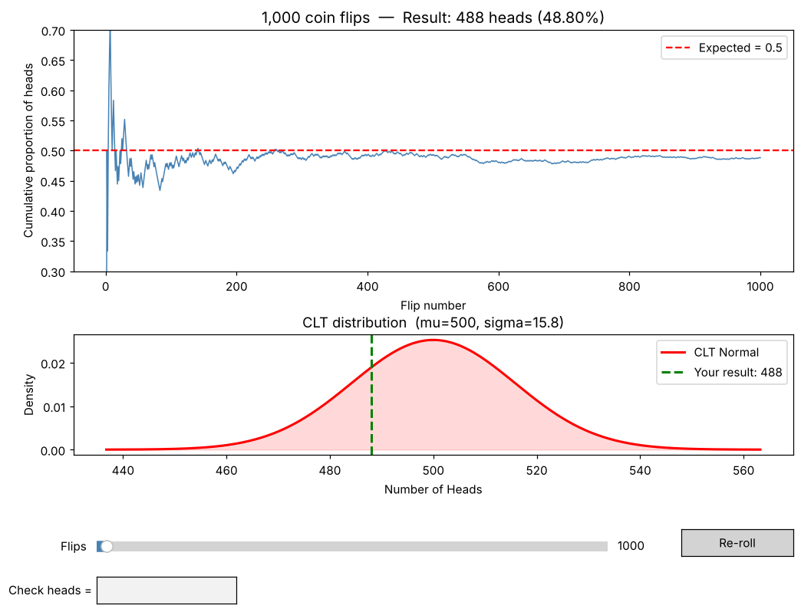

# Coin Flip Simulator: the Central Limit Theorem in action

An interactive simulation that flips thousands of coins and shows, live, how the result lines up with what probability theory predicts.



## What it shows

**Top chart: the Law of Large Numbers.** The running share of heads jumps around wildly over the first few flips, then settles closer and closer to 50% as the number of flips grows.

**Bottom chart: the Central Limit Theorem.** The number of heads in *n* flips follows a binomial distribution, which for large *n* is closely approximated by a normal distribution with

- mean μ = n · p
- standard deviation σ = √(n · p · (1 − p))

The green line marks where your simulated result lands on that curve.

## Controls

| Control | What it does |
|---|---|
| **Flips** slider | Set the number of flips (10 to 50,000) and re-run instantly |
| **Re-roll** | Run a fresh simulation with the same number of flips |
| **Check heads =** | Enter a number to see the CLT probability of getting exactly that many heads, and at least that many |

## Getting started

Requires Python 3.9+.

```bash
git clone https://github.com/Pepperpanda89/Coin-flip-simulator.git
cd Coin-flip-simulator
pip install -r requirements.txt
python coin_flip_simulator.py
```

## Built with

Python · NumPy · matplotlib · SciPy

## License

[MIT](LICENSE)
